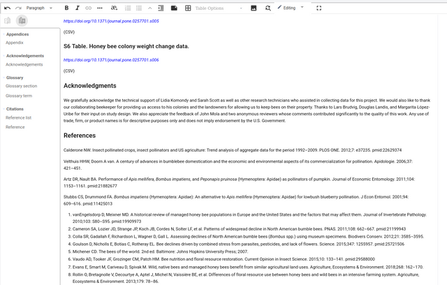
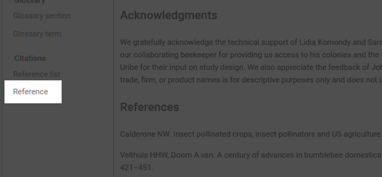
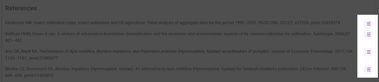
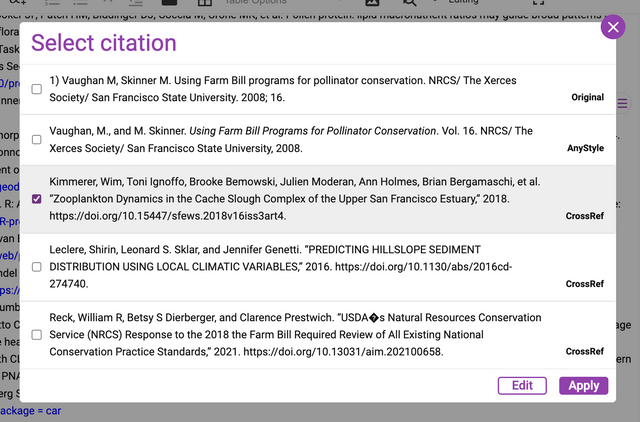
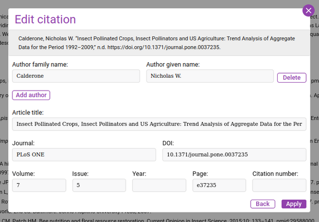

Kotahi can look a citation up against external services and offer you corrected versions of it. The tools sit on the Production page: open a manuscript's **Production** link from the Manuscripts page and scroll to the reference list.

The left-hand panel holds the reference tools.

Select a reference, then click the reference tool. A small menu appears beside it.

Choosing one of those icons opens the look-up overlay.

Each candidate is tagged with where it came from, and formatted in the citation style set for your group. Select one and click **Edit** to correct it — author names, article title, journal, DOI, volume, issue, year, page and citation number.

## Where the suggestions come from

Kotahi queries **Crossref**. It can also query **DataCite**, which is off until
someone turns it on, with an option to fall back to Crossref when DataCite
returns nothing. **AnyStyle** is different: it parses the text of the original
citation rather than looking it up anywhere.

These are third-party services, so results depend on them being available. If a
look-up returns nothing when you expected something, running it again later is
worth trying before assuming the citation is at fault.

:::caution[The Crossref fallback always returns something]
Crossref answers every query. With the fallback on, a reference DataCite could
not match will still come back with candidates — and they may be wrong. Treat
results that arrive this way as suggestions to check, not corrections to accept.
:::

## The settings behind it

Choose **Configuration** in the left menu, then the **Production** tab. That is
where the contact address sent to Crossref, how many candidates a look-up offers
(three unless you change it), whether DataCite is queried at all, and the
citation style and locale are set. The styles are APA, Chicago note-bibliography
and Council of Science Editors alphabetical. See
[Settings: Production](../../reference/settings-production/).
